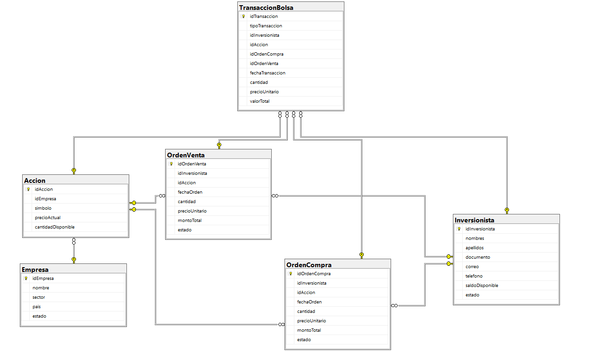
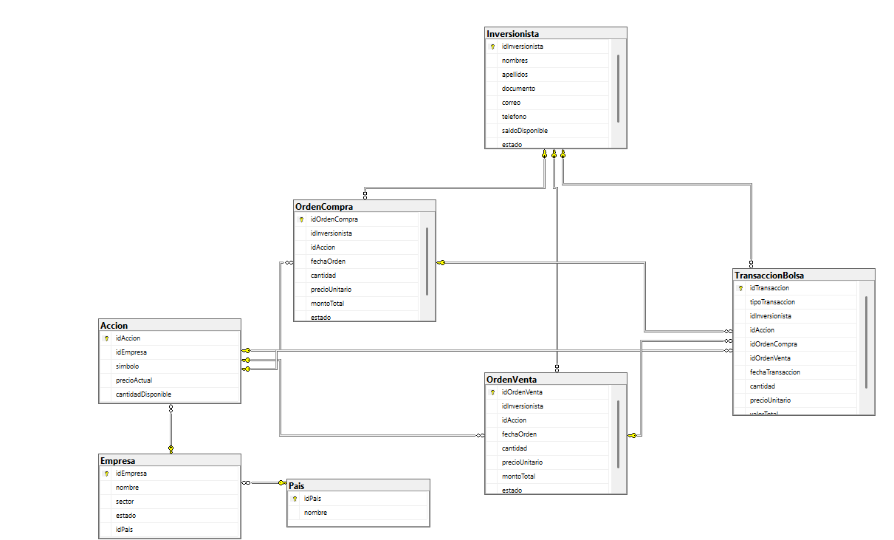

# Actividad SQL: Bolsa de Valores

Segunda actividad de la segunda unidad (Institución Universitaria ITM) desarrollada en **SQL Server** sobre el modelo *Sistema de Compra de Acciones en Bolsa*: inversionistas, empresas, acciones, órdenes de compra y venta, y transacciones.

## Orden de ejecución

1. `01_DDL_BolsaValores.sql`: crea la base de datos y las 6 tablas (borra y recrea si ya existe).
2. `02_DML_BolsaValores.sql`: carga los datos de prueba. Ejecutar **una sola vez** después del 01.
3. Del `03` al `10`, en orden y bloque por bloque.

## Contenido

| Archivo | Tipo | Punto de la guía |
| --- | --- | --- |
| `01_DDL_BolsaValores.sql` | DDL | Base de datos y tablas |
| `02_DML_BolsaValores.sql` | DML | Datos de prueba (10 registros por tabla) |
| `03_Punto1.sql` | DML | Modelo relacional, LEFT JOIN vs INNER JOIN, agrupamiento |
| `04_Punto2.sql` | DDL | ALTER TABLE, clave foránea, CHECK, sp_rename, índice |
| `05_Punto3.sql` | DML | Operadores, IS NULL, LEFT/RIGHT JOIN, GROUP BY/HAVING, subconsultas |
| `06_Punto4.sql` | DML | UNION, INTERSECT, EXCEPT y funciones |
| `07_Punto5.sql` | DDL + DML | Vistas con 3 INNER JOIN, WHERE y HAVING |
| `08_Punto6.sql` | DDL + DML | Tablas temporales a partir de un INNER JOIN |
| `09_Punto7.sql` | DML | IIF |
| `10_Punto8.sql` | DML | CASE |

## Cambios al modelo original

- Tabla `Pais` con clave foránea desde `Empresa` (el país era texto libre).
- CHECK que valida que una transacción de compra solo tenga orden de compra y una de venta solo orden de venta.
- CHECK de longitud del teléfono del inversionista.
- Índice no agrupado sobre `OrdenCompra(idInversionista)`.

| Antes | Después |
| --- | --- |
|  |  |

Requiere SQL Server 2016 SP1 o superior (`CREATE OR ALTER VIEW`, `DROP TABLE IF EXISTS`).
